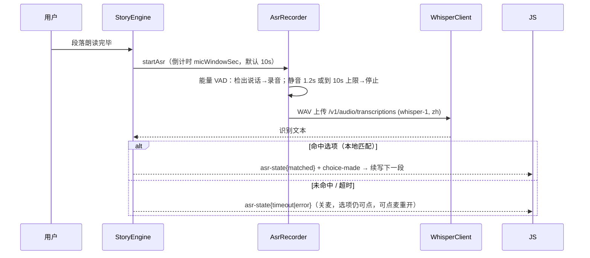

# Reverie — 睡前互动故事 App · 技术规格

> Android 原生壳 + WebView 全 UI。LLM 现编故事 → 系统 TTS 讲读 → 段末弹选项（点击 / 语音）→ LLM 续写。
> 仓库：`Offblink/Reverie` · 本地：`Desktop/Vibe Coding/useful/Reverie`

## 1. 已确认决策（2026-10-30 用户拍板）

| 项 | 决定 |
|---|---|
| 项目名 | **Reverie** |
| TTS | **系统 TTS**（`android.speech.tts.TextToSpeech`），起步不接云 TTS |
| LLM | **设置页自填 OpenAI 兼容配置**：baseURL / apiKey / chatModel，key 不进 git |
| ASR | **端上识别**：sherpa-onnx + zipformer2 CTC 中文 int8（26MB 内置模型，默认，离线可用）；云端 whisper 可选（独立 asrEndpoint/asrApiKey，MiMo 等无 transcriptions 网关的解法） |
| 无响应行为 | **严格超时**：段末开麦一个窗口，超时关麦、选项仍可点；睡着 = 停在当前选择页，下次续听。**不做**哄睡自动选择 |
| 设计 | **深色 Liquid Glass**（Mobile-Design 的 glass 组件移植）+ **Blinvo zoom-transition** 页间转场 |
| 鬼故事 | **惊悚度不做应用侧限制**，按 LLM 提供方自身边界 |
| 长度 | 短 ≈20min / 中 ≈60min / 长 ≈100min（朗读时长口径，见 §5） |
| 技术栈 | Java、minSdk 26 / targetSdk 37 / compileSdk 37、OkHttp、单 Activity |

## 2. 产品核心循环

```
选主题 + 选长度 ─→ LLM 生成第 1 段 ─→ TTS 逐句朗读 ─→ 段落读完
     ↑                                                ↓
     │                                     选项卡浮现 + 自动开麦（倒计时）
     │                                                ↓
     └──── LLM 按选择续写下一段 ←── 用户点击 或 语音选择（超时关麦）
                            …… 循环至目标互动数 ─→ 结局段（is_final）→ 完结
```

- 每个「互动单元」= 一段正文（约 400 字）+ 2–4 个选项。
- 故事状态每次变更即落盘（§4），睡着 / 杀进程 / 锁屏都不丢。
- 已生成的故事可**反复听**：重听模式顺序朗读全文，不重新生成。

## 3. 架构

### 3.1 域分工

| 域 | 组件 | 职责 |
|---|---|---|
| 原生 | `MainActivity` | WebView 壳、edge-to-edge、权限请求 |
| 原生 | `ReverieBridge` | `@JavascriptInterface`，JS→原生全部入口 |
| 原生 | `engine/LlmClient` | OkHttp SSE 流式 chat/completions |
| 原生 | `engine/StoryEngine` | 状态机：生成→TTS→开麦→选择→生成…；编排者 |
| 原生 | `engine/Story` + `StoryStore` | 数据模型 + `filesDir/stories/<id>.json` |
| 原生 | `engine/TtsPlayer` | 系统 TTS，逐句入队，UtteranceProgressCallbacks |
| 原生 | `engine/AsrRecorder` + `engine/DeviceAsr` | AudioRecord 16k PCM→WAV + VAD；sherpa-onnx 端上转写（M7） |
| 原生 | `engine/WhisperClient` | 云端 whisper 上传（M5，asrMode=cloud 时用） |
| 原生 | `Settings` | SharedPreferences：endpoint/key/model/音色/语速/麦克风窗口 |
| WebView | `assets/web/` | **全部可见 UI**：主页 / 书架 / 故事页 / 设置页，深色玻璃视觉 |

原则：原生是引擎（生成、播音、录音、持久化），web 是皮（渲染、输入、转场）。web 重载后主动 `getState` 拉全量快照即可恢复画面。

### 3.2 桥契约（改一边必须同步另一边）

**JS → 原生** `window.Reverie.<method>(...)`（同步，JSON 字符串返回，异常回 null）：

| 方法 | 参数 | 返回 |
|---|---|---|
| `getState` | — | 全量快照 `{settings(不含key), story, busy, screenHint}` |
| `newStory` | `{theme, tier}` | `{id}` 立即建档并开始生成第 1 段 |
| `choose` | `{index}` | `{ok}` 记录选择并触发下一段生成 |
| `replay` | `{fromSegment?}` | `{ok}` 重听模式：从指定段顺序朗读 |
| `stopReplay` | — | `{ok}` |
| `replaySegment` | `{index}` | `{ok}` 重播单段（续听时「重播本段」） |
| `listStories` | — | `[{id,title,theme,tier,status,updated,progress}]` |
| `openStory` | `{id}` | `{ok}` |
| `deleteStory` | `{id}` | `{ok}` |
| `getSettings` | — | 设置对象（**不含 apiKey**，仅 `hasKey:bool`） |
| `setSettings` | `{...}` | `{ok}`（语速/音色即时生效，无需重启朗读） |
| `getVoices` | — | `[name,…]` TTS 音色清单（zh 优先；TTS 未就绪为空表） |
| `testEndpoint` | — | `{ok, latencyMs, msg}` 连通性探测 |
| `startAsr` / `stopAsr` | — | `{ok}` / `{ok, needPermission}`（无 RECORD_AUDIO 时先弹系统授权） |

**原生 → JS** `Host.onEvent(ev)`：

| event | 载荷 | 时机 |
|---|---|---|
| `segment-delta` | `{index, text}` | 流式增量，web 追加渲染 |
| `segment-done` | `{index, text, options, isFinal}` | 一段生成完毕（未朗读） |
| `tts-state` | `{state: playing\|idle, index}` | TTS 开始/结束一段 |
| `choice-made` | `{index, choiceIndex, heard?}` | 选择已记录（点击或语音） |
| `asr-state` | `{state: listening\|matched\|timeout\|error, index?, heard?, choiceIndex?, windowSec?, msg?}` | 麦克风状态机（listening 带窗口秒数供倒计时环；未命中走 timeout+heard；error 带 msg） |
| `story-done` | `{id}` | 结局段朗读完 |
| `error` | `{stage: llm\|tts\|asr, msg}` | 任一环节失败 |

`Host.onState(st)`：结构性变化（新故事 / 打开 / 删除 / 完结）后原生推全量快照。

### 3.3 页面与导航

单 Activity + 单 `index.html` + 四视图页内路由（zoom-transition 需要同文档动画，跨 Activity 做不到）：

```
主页(主题网格12 + 长度三挡 + 开始)   ←→   书架(进行中/已完成)
        │ zoom-in                      │ zoom-in
        └────────→ 故事页 ←────────────┘
                    ↕ 页内滑动/淡入
                 设置页(顶栏齿轮)
```

## 4. 数据模型与持久化

`filesDir/stories/<id>.json`（org.json 手写序列化，一书一份，选择即写盘）：

```json
{
  "id": "1730300000000", "title": "雾港来信", "theme": "悬疑", "tier": "short",
  "created": 1730300000000, "updated": 1730301200000,
  "status": "active",             // active | done
  "choicesTarget": 10,
  "synopsis": "（LLM 维护的滚动剧情梗概）",
  "segments": [
    { "index": 0, "text": "…400字…",
      "options": ["…","…","…"],   // 结局段为空数组
      "choice": -1,                // -1=未选；0..n=用户选的下标
      "heard": null,               // 语音识别原文（若有）
      "isFinal": false }
  ],
  "replayState": { "pos": 0 }     // 重听进度，可选
}
```

- 写盘时机：新档、每段生成完毕、每次选择。写入走临时文件 + rename（崩溃安全）。
- 设置存 SharedPreferences：`endpoint / apiKey / chatModel / asrMode / asrModel / asrEndpoint / asrApiKey / ttsVoice / ttsRate / micWindowSec / keepScreenOn`。`asrMode` 默认 `device`（端上模型）；`asrEndpoint/asrApiKey` 留空 = 跟随 LLM 配置。apiKey 只在原生域，**永不**经桥下发给 JS。

## 5. LLM 契约

### 5.1 请求

`POST {endpoint}/chat/completions`，`stream: true`，OpenAI 兼容。messages：

- **system**：叙述者人设 + 主题风格块（§5.4）+ JSON 输出契约（§5.3）+ 进度指令：
  「你在写第 {i}/{total} 个互动段；当 i == total 时写结局段，`is_final: true` 且 `options: []`」。
- **user**：`synopsis` + 最近 6 段原文 + **全部选择史**（每次选择的选项文本）+ 本次新选择。

### 5.2 上下文策略

- 选择史全量携带（每条几十字，50 段也廉价）。
- 正文只带最近 6 段原文；更早剧情靠 LLM 自维护的 `synopsis` 字段（每次响应更新）。
- 32K 上下文足够：最坏 ≈ 6×400 + 50×50 + synopsis ≈ 8K token。

### 5.3 输出契约

```json
{ "title": "…",            // 仅第 1 段返回
  "segment": "…约350–450字…",
  "options": ["…", "…"],   // 2–4 个；结局段 []
  "is_final": false,
  "synopsis": "…" }
```

- system 里强制 JSON；解析时容忍 markdown code fence，取首个 `{…}` 块。
- **流式切句**：增量文本中提取 `segment` 字段值，按 `。！？!?…` 切句逐句送 TTS——第 1 句 1–2 秒即开讲，选项在段末（JSON 尾部）到达时才浮现。这是核心体验，不等整段生成完。
- 生成失败（SSE 断 / JSON 解析失败）：丢弃半段不落盘，`error{stage:llm}` → web 显示「重试」按钮（重新请求同一段）。

### 5.4 主题清单（12）

| 主题 | 风格块要点 |
|---|---|
| 鬼故事 | 惊悚度**不限制**；氛围、怪谈、中式恐怖均可 |
| 悬疑推理 | 线索公平、每段埋钩子 |
| 恋爱 | 暧心动人、双向奔赴 |
| 穿越 | 时代错位感、历史细节 |
| 奇幻 | 魔法体系、异世界 |
| 科幻 | 硬边设定或太空歌剧 |
| 武侠 | 江湖恩怨、武功招式 |
| 古风宫斗 | 权谋、步步惊心 |
| 校园青春 | 轻松日常、成长 |
| 治愈日常 | 温柔慢节奏，助眠首选 |
| 童话幻想 | 适龄奇幻冒险 |
| 末日生存 | 生存压力、人性抉择 |

### 5.5 长度挡位

| 挡位 | 互动数 total | 全文字数 | 目标朗读时长（0.9x 语速 ≈200 字/分） |
|---|---|---|---|
| short | 10 | ≈4,000 字 | ≈20 min |
| medium | 30 | ≈12,000 字 | ≈60 min |
| long | 50 | ≈20,000 字 | ≈100 min |

段均 350–450 字由 system 约束；实际按语速换算，允许 ±20%。

## 6. TTS 规格

- 引擎：系统 `TextToSpeech`，`Locale.CHINA`；音色从 `getVoices()` 列表供设置页选择；默认语速 **0.9**（睡前慢速），可调 0.7–1.1。
- 逐句入队（§5.3 切句），`UtteranceProgressCallbacks.onDone` 推进下一句；全部句读完 → `tts-state{idle}` → web 浮现选项 + 原生自动 `startAsr`。
- 屏幕策略：故事页默认 `keepScreenOn`（设置可关）；锁屏/后台不停止当前段朗读，但不再自动开麦（录音需前台）。
- 引擎未就绪 / 无中文包（模拟器 AOSP 常见）→ 降级纯文字模式并提示，故事流程不中断。

## 7. ASR（语音选择）规格



- 权限：`RECORD_AUDIO` 运行时申请；拒绝 → 仅点击模式。
- **选项匹配（本地，零额外请求）**：① 序号词（一/二/三/第一/1/2/…）→ 下标；② 归一化（去「选/第/个/吧/。」）后与选项文本做包含/相似度，≥0.5 取最高；③ 未命中视为无效响应。
- 录音参数：16 kHz / mono / 16-bit PCM，直接封装 WAV（不引 lame）。
- 识别方式（`asrMode`）：**device（默认）** = sherpa-onnx 端上 zipformer2 CTC 中文 int8（26MB 内置，启动后台预热，离线可用）；**cloud** = 上传 whisper 端点。
- 端点：云端模式走 `asrEndpoint/asrApiKey`（留空回落 LLM 的 endpoint/key）——LLM 用无 transcriptions 接口的网关（如 MiMo）时，给语音单独配一个 OpenAI 兼容端点即可。
- whisper 失败（网络/余额）→ `asr-state{error}`，回落点击模式，不阻塞故事。端上模型未就绪/失败同口径。

## 8. 设计规范

- 视觉：移植 Mobile-Design `shared/glass.css` + `tokens.css` 的深色配方——玻璃只属于浮在内容上的控件层（顶栏、选项卡、麦克风按钮），正文层永远不透明深色底；Reduce Transparency 回退；`prefers-reduced-motion` 降级。
- 转场：移植 `blinvo-design/zoom-transition`（FLIP，进 280ms / 出 240ms，`fast_out_slow_in`，不回弹）用于 主页/书架 → 故事页。
- 故事页：正文流式追加渲染 + 当前朗读句高亮（随 `tts-state`/切句进度移动）；底部玻璃选项卡 2–4 枚；麦克风按钮带倒计时环；顶栏玻璃条显示 `第 3/10 段 · 主题`。
- 文件安全：不引 CDN、不用 ES modules、不用 fetch 外链（file:// 约束，与 Mobile-Design 同规则）。
- edge-to-edge：透明系统栏全屏 WebView，web 侧用 `env(safe-area-inset-*)` 留边（参考 android/skills `system/edge-to-edge`）。

## 9. 权限与安全

- `INTERNET` + `RECORD_AUDIO`（运行时）；无相机/定位/前台服务（v1 不做后台播放）。
- apiKey 存 SharedPreferences，构建期零注入、git 零出现；发布前跑一遍密钥扫描。
- WebView：`file:///android_asset/web/index.html`，禁文件访问收敛、禁剪贴板外泄、JS 桥只暴露 §3.2 方法。

## 10. 增量计划与验收

| 增量 | 内容 | 验收 |
|---|---|---|
| M0 | Gradle 脚手架、Manifest、空 MainActivity | `assembleDebug` 过，装机出空壳页 |
| M1 | WebView 壳 + 桥 + 四视图静态页 + glass 视觉 + zoom 转场 | 真机/模拟器可导航，桥自检日志过 |
| M2 | StoryEngine + LlmClient + StoryStore + 文字版闭环（原 M3 文字版验收并入） | 选主题→流式生成→点击选择→到结局→落盘可重开 |
| M4 | TTS 逐句朗读 + 句高亮 + 读完才弹选项 + 重听 | 短故事全程听读，断点续听、重听 |
| M5 | ASR：录音/VAD/whisper/匹配 + 倒计时环 + 运行时权限 | 语音选择闭环，超时关麦回落点击（语音命中链路需真机复验，模拟器无音频输入） |
| M6 | 书架删除手势 + 设置音色/语速 + 边角打磨 | 三挡各跑通一遍，60min 无崩溃 |

每增量收尾：`assembleDebug` + 该增量直接触及路径的冒烟；UI 改动真机截图验收。

## 11. 风险

| 风险 | 缓解 |
|---|---|
| 模拟器 AOSP TTS 无中文 | TTS/ASR 阶段以真机（小米）为主验证；M0–M2 纯文字不受影响 |
| whisper 需网络与 key | 设置页「测试连接」；失败自动回落点击 |
| 长故事 LLM 漂移（角色/伏笔丢失） | synopsis 字段 + 选择史全量携带 |
| SSE 中断 | 半段丢弃 + 重试按钮，不落盘脏数据 |
| WebView file:// 限制 | 与 Mobile-Design/Spore 同规则：无模块、无外链 fetch |

## 12. Out of scope（v1 不做）

哄睡自动选择 / 云 TTS / 离线缓存预生成 / 账号同步 / iOS / 自由对话式语音（非选项语音一律视为未命中）/ 前台服务后台播放。
